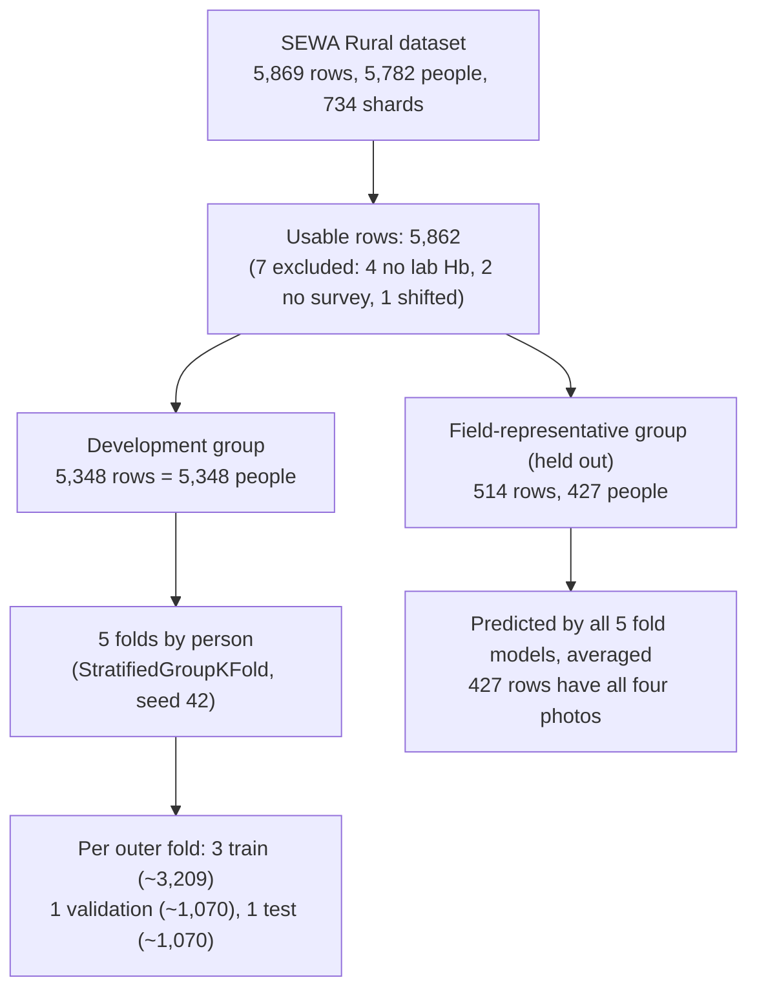
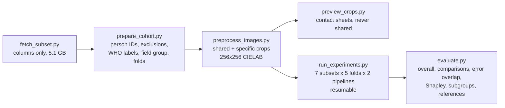
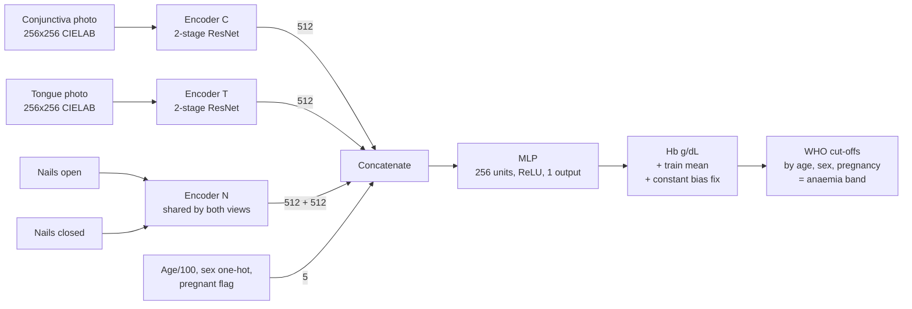

# Research Study Guide: Site-Specific Smartphone Anaemia Screening

> **What this file is.** Everything about our research model in one place: the problem, the base paper, the three other reference papers, our methodology, every result we have so far, how we compare, what is new, what is not done yet, and a slide-by-slide plan for the PPT.
>
> **Status date:** 2 November 2026. The **shared pipeline** (35 models) has finished and been evaluated. The **site-specific pipeline** is built but **not trained yet**. Anything marked *(planned)* or *(not done)* must not be presented as a result.
>
> **Source of every number:** our results come from `data/results/*.csv` (produced by `evaluate.py`). Base-paper numbers come from Desai et al. 2026 and its appendix. Other papers' numbers come from the PDFs themselves. Our numbers and theirs come from different patients and splits, so **never put them side by side as if they were one experiment** (see Section 9).

---

## Table of contents

1. [The project in one page](#1-the-project-in-one-page)
2. [Background: why anaemia screening matters](#2-background-why-anaemia-screening-matters)
3. [The base paper (Desai et al., 2026) in detail](#3-the-base-paper-desai-et-al-2026-in-detail)
4. [The three other reference papers](#4-the-three-other-reference-papers)
5. [Research gap, research questions and contributions](#5-research-gap-research-questions-and-contributions)
6. [Dataset: what we used and what we found in it](#6-dataset-what-we-used-and-what-we-found-in-it)
7. [Methodology: our model and pipeline](#7-methodology-our-model-and-pipeline)
8. [Results (shared pipeline)](#8-results-shared-pipeline)
9. [Comparison with the reference papers](#9-comparison-with-the-reference-papers)
10. [Where we lead](#10-where-we-lead)
11. [New features not in previous work](#11-new-features-not-in-previous-work)
12. [Interpretation: verdict per site (provisional)](#12-interpretation-verdict-per-site-provisional)
13. [What is not done yet, and open decisions](#13-what-is-not-done-yet-and-open-decisions)
14. [Limitations](#14-limitations)
15. [Future work](#15-future-work)
16. [PPT plan, slide by slide](#16-ppt-plan-slide-by-slide)
17. [Likely questions and how to answer them](#17-likely-questions-and-how-to-answer-them)
18. [Glossary](#18-glossary)
19. [References](#19-references)

---

## 1. The project in one page

**Research question:** Do tongue and nail-bed photographs add anything beyond the conjunctiva (inner lower eyelid) when a smartphone is used to estimate haemoglobin (Hb) and screen for anaemia? If they add nothing, **why**?

**Working title:** *Site-specific deep learning for smartphone anemia screening: re-examining whether tongue and nail-bed images add value beyond the conjunctiva.*

Alternative titles (choose once all results are in):
- *Do tongue and nail-bed images add value beyond the conjunctiva? A cross-validated re-examination of smartphone anemia screening*
- *Redundant or under-modelled? Testing tongue and nail-bed images for smartphone hemoglobin estimation*

**The story in five lines**
1. The base paper (SEWA Rural and Google, 2026) photographed the conjunctiva, tongue and nails of about 5,900 people in rural Gujarat, with lab Hb as ground truth.
2. They kept **only the conjunctiva** because, in one appendix table, adding tongue and nails "did not improve performance".
3. That table has no confidence intervals or significance tests, uses one split and one fusion method, and runs every site through preprocessing designed for the eye.
4. We retrain **all 7 site combinations** with **5-fold person-level cross-validation**, **confidence intervals**, **paired significance tests**, **two preprocessing pipelines** and a **diagnosis framework** that explains why a site fails.
5. **First results (shared pipeline):** nails add a **small but statistically significant** improvement (MAE −0.027 g/dL, Holm p = 0.020), mostly for severe anaemia and children. The tongue adds **nothing** (p = 0.51). On the field group, nails **rank** people better but are **mis-calibrated** (about −2 g/dL bias). That is a new finding.

**Key facts**

| Item | Value |
|---|---|
| Ground truth | Venous Hb, Sysmex XN-550 analyser (`cbc_hgb_g_dl`) |
| Sites | C = conjunctiva (1 photo), T = tongue (1 photo), N = nail bed (2 photos: open hand and closed fist) |
| Output | Continuous Hb in g/dL, then WHO cut-offs (age, sex, pregnancy) give the anaemia band |
| Combinations | C, T, N, C+T, C+N, T+N, C+T+N |
| Design | 7 combinations × 5 folds × 2 pipelines = 70 runs (65 trained, because C is identical in both pipelines) |
| Done so far | Shared pipeline: 35 models, evaluated 2 Nov 2026 |
| Development set | 5,348 people, each predicted once by a model that never saw them |
| External check | Field-representative group: 514 images from 427 people (427 rows with all four photos) |
| Hardware | One NVIDIA RTX 3050 6 GB laptop GPU. About 19 min per conjunctiva-only model, about 25 h per pipeline |
| Out of scope | PPG video (about 650 GB; the base paper found it no better). Future work |

---

## 2. Background: why anaemia screening matters

### 2.1 Burden
*(Figures as cited by the base paper; check each against the primary source before using it on a slide.)*
- Anaemia affects **over 2 billion people** worldwide.
- About **40% of children under five**, **37% of pregnant women** and **30% of women of reproductive age** are affected globally.
- In **India**, NFHS-5 (2019–21) reports prevalence as high as **67% in children** and **57% in women**.
- Treatment (iron, folate, B12, transfusion) works once anaemia is detected, so **detection is the bottleneck**. **Severe anaemia** is the most time-critical group.

### 2.2 Why current detection falls short

| Method | Strength | Problem |
|---|---|---|
| Lab analyser (venous CBC) | Gold standard | Needs phlebotomy, a laboratory, power, reagents and logistics. Hard in remote villages |
| Point-of-care blood test (HemoCue) | Accurate (MAE about 0.5 g/dL) | Still needs a blood sample, trained staff, consumables and a supply chain |
| Clinical exam for pallor | Free and needle-free | Unreliable: **73% sensitivity, 53% specificity** for any anaemia and only **31% sensitivity for severe** in the base paper's test set |
| **Smartphone photos** | Needle-free, cheap, scalable | Earlier studies were small and homogeneous, often with weak reference standards or image-level splits |

### 2.3 What a useful tool must achieve (base paper's stakeholder target)
- **≥ 80% sensitivity and ≥ 80% specificity**, especially for **severe** anaemia.
- A result within **30 seconds**, preferably **offline**, on **low-cost phones**, usable by a community health worker after minimal training.
- This is the benchmark our Discussion measures against.

### 2.4 Why the "which body site?" question matters in practice
- **Conjunctiva capture is hard in children.** The base paper reports trouble getting clear eyelid photos from 1–5-year-olds because they move. A **fallback site** (nails) would help them directly.
- **Every extra photo costs field time.** If tongue or nails add nothing, drop them. If they add something, dropping them loses accuracy.
- **Each site has its own failure modes:** henna and polish on nails, cold fingers, saliva glare on the tongue, staining from betel or tobacco.
- **A weak "did not help" can close a research line too early.** Future datasets might stop collecting nails and tongue.

---

## 3. The base paper (Desai et al., 2026) in detail

**Citation:** Desai S, Gadgil S, Gottala VA, et al. *Smartphone-based Non-Invasive Classification of Anemia Severity using Deep Learning: A Cross-Sectional Study in Rural India.* medRxiv, posted 26 Oct 2026 (preprint, not peer reviewed). doi:10.64898/2026.10.22.26366247

**Code:** github.com/Google-Health/google-health/tree/master/non-invasive-anemia-ai. It has preprocessing and an untrained single-image model, but **no training script and no multi-site model**.

### 3.1 Study design

| Aspect | What they report |
|---|---|
| Design | Prospective cross-sectional study, SEWA Rural hospital, rural tribal Gujarat (serves more than 2,500 villages). Funded by the Gates Foundation |
| Ethics | SEWA Rural IEC (31 Mar 2023), CTRI/2023/07/055313, written informed consent |
| Participants | Ages 1–89, including pregnant women, all with a clinician-ordered CBC |
| Sampling | Non-consecutive and **enriched for severe anaemia** (target about 25% per Hb category). People with non-removable henna were not enrolled |
| Numbers | 5,455 captures (Jul 2024 – Nov 2025). 279 excluded, leaving 5,176. Split **70:15:15** into 3,623 train / 776 validation / 777 test |
| Field group | 516 images from 429 people (Dec 2025 – Jan 2026), collected indoors and outdoors |
| Composition | Normal 27.0%, mild 25.2%, moderate 34.1%, severe 13.7%. 83.7% female. Mostly obstetrics and gynaecology (56.8%) and general medicine (31.5%) outpatients |
| Phones | Samsung A05, A14 and S24 (low to high cost) |
| Capture | Flash on, white paper reference in frame. Lower eyelid pulled down, tongue out, nails flat (open) and flexed (closed). Plus a 30 s fingertip PPG |
| References | Venous Hb (Sysmex XN-550) as ground truth. HemoCue Hb 301 on venous and capillary blood. Clinician exam (staff not blinded to Hb) |
| Quality control | A pathologist reviewed images. Poor or identity-revealing images were removed |

### 3.2 Their model
1. **Crop:** find the white paper edge with Canny edge detection and Hough lines, and take the region below it (the eye).
2. Resize to **256 × 256**, convert to **CIELAB**.
3. **Two-stage ResNet** (one block per stage), trained from scratch.
4. Image features are **concatenated** with **age, sex and pregnancy** status.
5. An **MLP** outputs continuous Hb.
6. **Training:** Adam with exponential decay, Huber loss, inverse-bin-frequency reweighting, plus one constant bias correction chosen on validation.
7. Hb is thresholded at **WHO cut-offs** to give the anaemia band.

### 3.3 Their published results (test set, n = 777). *Their numbers, not ours.*

| Measure | AI model (conjunctiva + metadata) | HemoCue | Clinician exam |
|---|---|---|---|
| Hb MAE (g/dL) | **1.12** (normal 1.19, mild 0.74, moderate 1.23, severe 1.43) | Venous 0.48, capillary 0.52 | n/a |
| Within ±1 g/dL | 54% | – | n/a |
| Bias, limits of agreement | −0.02, −2.90 to +2.85 | – | n/a |
| Any anaemia | Sens 70%, Spec 70%, **AUC 0.80** | Venous 86% / 99%, AUC 0.98 | 73% / 53% |
| Moderate or severe | **AUC 0.81** (0.824 in the appendix) | AUC 1.0 | 40% / 94% |
| Severe | Sens 90%, Spec 80%, **AUC 0.93** | Venous 82% / 100% | 31% / 100% |

**Field group (their Appendix 6):** any anaemia 66% / 69%; moderate or severe 73% / 69%; severe 95% / 78%. Accuracy dropped in bright outdoor light. They report stable accuracy across skin tone and phone model.

### 3.4 The ablation table we re-examine (their Appendix 8, validation n = 776, no confidence intervals)

| Inputs | MAE | AUC any | AUC mod/sev | AUC severe |
|---|---|---|---|---|
| **Baseline: conjunctiva + metadata** | **1.124** | 0.829 | 0.828 | 0.968 |
| Conjunctiva | 1.221 | 0.819 | 0.831 | 0.967 |
| Tongue | 1.824 | 0.656 | 0.665 | 0.810 |
| Nails open | 1.504 | 0.749 | 0.761 | 0.904 |
| Nails closed | 1.575 | 0.732 | 0.745 | 0.875 |
| Conjunctiva + tongue | 1.222 | 0.812 | 0.821 | 0.966 |
| Conjunctiva + nails open | 1.144 | **0.832** | **0.844** | 0.966 |
| Conjunctiva + nails closed | 1.202 | 0.804 | 0.831 | **0.978** |
| Tongue + nails open | 1.484 | 0.760 | 0.761 | 0.901 |
| Tongue + nails closed | 1.529 | 0.724 | 0.745 | 0.881 |
| Nails open + closed | 1.446 | 0.755 | 0.767 | 0.907 |
| Conj + tongue + nails open | 1.136 | 0.825 | 0.840 | **0.978** |
| Conj + tongue + nails closed | 1.173 | 0.804 | 0.823 | 0.967 |
| Conj + nails open + closed | 1.159 | 0.813 | 0.833 | 0.971 |
| Tongue + nails open + closed | 1.389 | 0.765 | 0.782 | 0.913 |
| All image sites | 1.139 | 0.822 | 0.836 | 0.968 |
| Conjunctiva + metadata + symptoms | 1.099 | 0.837 | 0.839 | 0.973 |
| Metadata only (ElasticNet / RF) | 1.634 / 1.610 | 0.571 / 0.618 | 0.611 / 0.625 | 0.719 / 0.737 |
| Symptoms only (ElasticNet / RF) | 1.631 / 1.616 | 0.564 / 0.564 | 0.608 / 0.608 | 0.748 / 0.768 |

### 3.5 Why this table leaves room for our study (the seven weaknesses)
1. **No uncertainty.** Point estimates only, no CIs or tests, on 776 people. Gaps of 0.01–0.02 cannot be read by eye.
2. **A possible apples-to-oranges comparison.** Image rows appear to exclude metadata: conjunctiva alone is 1.221, conjunctiva + metadata is 1.124. Among image-only rows, C + T + nails-open (1.136) actually beats conjunctiva alone (1.221). *(Say "appears to"; the appendix does not state it.)* Our design removes this: **every model gets the same metadata.**
3. **The claim rests on MAE only.** On AUC, several combinations match or beat the baseline (C + nails open: 0.832 / 0.844 vs 0.829 / 0.828; two rows reach 0.978 severe vs 0.968).
4. **One split.** No repeated folds.
5. **One fusion method.** Concatenation only.
6. **Preprocessing built for one site.** Only the conjunctiva crop is described. How tongue and nails were cropped is unknown.
7. **No explanation.** "Limited complementary information" is stated, not tested.

### 3.6 Inconsistencies inside the base paper (cite the version you use)

| Item | Version A | Version B |
|---|---|---|
| Learning rate | 0.02 (Methods) | 0.013 (Appendix 5) |
| Batch size | 64 (Methods) | 32 (Appendix 5) |
| Test MAE | 1.12 (main text) | 1.111 (Appendix 8) |
| Mod/sev test AUC | 0.81 (Results) | 0.824 (Appendix 8) |
| Symptoms model, any-anaemia AUC | 0.937 (Results) | 0.837 (Appendix 8) |
| Ablation MAE unit | mg/dL (typo, Results) | g/dL (everywhere else) |
| Severe cut-off, ages 5–11 | < 8.0 g/dL (Appendix 4, matches WHO) | < 7 g/dL (released code) |
| Block design | 3 convolutions per block (Appendix 3 diagram) | 2 convolutions ("basic", released code default) |
| Significance level | P < 0.05 (sample size) | P < 0.025 (analysis) |

### 3.7 Limitations the authors state (these apply to us too, because we use their data)
- Accuracy is below invasive point-of-care devices (HemoCue).
- Hb is **over-predicted in severe cases** and **under-predicted** in the normal, mild and moderate groups (regression to the mean).
- A single-hospital population may not generalise to other skin tones or conditions.
- Staff were not blinded to Hb (affects the clinician comparison).
- Non-consecutive enriched sampling tends to **overestimate** diagnostic accuracy.
- Needs validation in real community settings.

---

## 4. The three other reference papers

### 4.1 Zhao et al., 2024, PLoS One: conjunctiva app (eMoglobin)
**Citation:** Zhao L, Vidwans A, Bearnot CJ, Rayner J, Lin T, Baird J, Suner S, Jay GD. *Prediction of anemia in real-time using a smartphone camera processing conjunctival images.* PLoS One 2024;19(5):e0302883.

| Aspect | Detail |
|---|---|
| Site | Palpebral conjunctiva only (both eyes, at least 4 images per person) |
| Setting | Emergency Department, Rhode Island Hospital, USA. Prospective convenience sample, June 2022 – Feb 2023 |
| People | 435 enrolled, **426 analysed**. Adults only (19–94, mean 53). 55.2% women. 75.6% light skin |
| Hb range | 3.2–18.8 g/dL (mean 12.6). Only **18.3%** had moderate or worse anaemia |
| Phone and capture | iPhone X, **RAW** images, **no flash**, ambient indoor light, 3–6 inches away. A research assistant **manually selects the ROI** |
| Method | **No deep learning.** Computes a "high hue ratio" from the ROI and maps it to Hb through a previously derived correlation. Runs in the app in real time |
| Results | Accuracy **75.4%** (95% CI 71.3–79.4) across categories. Any anaemia: sensitivity **54.3%**, specificity **89.7%**, **AUC 0.76** (women 0.74, men 0.79) |
| Transfusion thresholds | < 9 g/dL: accuracy 91.1%, sens 58.3%, spec 96.5%, **AUC 0.90**. < 7 g/dL: accuracy 92.7%, sens 69.6%, spec 94.0%, **AUC 0.92** |
| Agreement | Bland–Altman bias **0.10**, LoA **−4.73 to +4.93 g/dL** (wide) |
| Other | Operator (RA) effect explained 3.4% of variance. The app capped the displayed Hb at 14 g/dL |
| Their limitations | Few severe cases; lighting not controlled; manual ROI; single centre |
| **Relevance to us** | Earlier conjunctiva-only evidence. Small, adult, mostly light-skinned and US-based. Single site, so it says nothing about tongue or nails. A hand-crafted colour feature instead of a learned model |

### 4.2 Mannino et al., 2018, Nature Communications: fingernail app
**Citation:** Mannino RG, Myers DR, Tyburski EA, et al. *Smartphone app for non-invasive detection of anemia using only patient-sourced photos.* Nat Commun 2018;9:4924.

| Aspect | Detail |
|---|---|
| Site | **Fingernail beds** only |
| Setting | Children's Healthcare of Atlanta / Emory, USA. 337 subjects total (162 sickle-cell, other anaemias, cancers, plus 72 healthy controls). 167 female, 170 male |
| Exclusions | Leukonychia, nail injury, **nail polish**, dark discolouration |
| Capture | Smartphone with flash, about 0.5 m away, fingers curled. The **user selects ROIs** on the nails. A **quality-control** step drops pixels outside expected colour ranges |
| Method | **No deep learning.** Colour features (CIELAB; L* used as a skin-tone indicator) plus metadata in a **multi-linear regression** |
| Results (test n = 100) | Mean absolute error about **0.97 g/dL** (r = 0.82). Bias 0.2. **LoA ±2.4 g/dL**. **AUC 0.88** |
| Screening cut-offs | < 12.5 g/dL: **sensitivity 97%** (89–100%). < 11.0 g/dL: sensitivity 92%, specificity 76% |
| Personalised calibration | Per-patient algorithm on **4** chronically transfused patients (16 measurements): **LoA ±0.92 g/dL** |
| vs hematologists | 5 hematologists looking at nail photos: LoA ±4.6, AUC 0.63. App on the same 50 subjects: LoA ±1.0, AUC 0.94 |
| Robustness | Reports minimal effect of skin tone and background lighting |
| **Relevance to us** | Shows **nails can carry a strong Hb signal**, so our weaker nail-only result **needs an explanation** (crop failure, population, henna, automated vs manual ROI). The population is very different: US, many chronic genetic anaemias, polish excluded, manual ROI. Personalisation is a future-work idea |

### 4.3 Lin et al., 2025, Journal of Imaging Informatics in Medicine: BPANet (multi-body-part)
**Citation:** Lin ET, Lu SC, Liu AS, Ko CH, Huang CH, Tsai CL, Fu LC. *Deep Learning-Based Model for Non-invasive Hemoglobin Estimation via Body Parts Images: A Retrospective Analysis and a Prospective Emergency Department Study.* J Imaging Inform Med 2025;38:775–792. doi:10.1007/s10278-024-01209-4

| Aspect | Detail |
|---|---|
| Sites | Conjunctiva, **palm**, fingernail. **One image at a time**: the model takes any one body part plus a "body part tag" (one-hot, length 4) |
| Why one at a time | They state that **no paired multi-site dataset existed**, and that requiring three photos each time would hurt usability |
| Architecture | **ResNet-50** backbone. **Channel-Spatial Attention (CSA)** between stages 1 and 2 (focuses on the conjunctiva region). **Fusion Attention** combines image features with **age, gender and the body-part tag**. **Dual Loss** (regression plus classification over N = 48 Hb bins from 0–24 g/dL) for imbalance |
| Preprocessing | Two morphological openings to remove reflections, resize to 224 × 224 |
| Training | Adam, lr 1e-4, batch 16. 140 epochs (5-fold) on Eyes-Defy-Anemia; 150 epochs (4-fold) on NTUH |
| Retrospective data | **Eyes-Defy-Anemia** (eye photos from Italy and India; the paper says 218 patients). 5-fold CV |
| Retrospective results | **MAE 1.212**, accuracy **0.849**, recall 0.876, precision 0.798, **F1 0.828** (vs the dataset authors' accuracy 0.83) |
| Ablation | No modules: MAE 1.479. All three modules: 1.212. Age + gender table reports 1.121 for the full model, which disagrees with 1.212 elsewhere in the paper |
| Prospective data | NTUH emergency department, **101 patients**, 268 images (100 conjunctiva, 85 palm, 83 nail). 4-fold CV |
| Prospective results | **MAE 2.024**, accuracy 0.716, recall 0.857, precision 0.718, F1 0.788 |
| Per site (NTUH) | Conjunctiva MAE 2.006, **palm 1.844 (best)**, fingernail 2.232 (worst). Ranking: palm > conjunctiva > fingernail |
| Validation caveat | The paper does not say folds were grouped by patient. NTUH folds were "evenly distributed" by body part, so one person's images may fall in different folds |
| **Relevance to us** | Closest multi-site precedent, but it **never fuses sites per patient** and ranks sites on a few hundred images. We have **paired photos of all sites for 5,348 people** and fuse them per person. Their attention fusion is a precedent for our planned attention-fusion experiment |

### 4.4 Other related work (from the base paper's discussion; read before citing)

| Study | Site | What is reported | Use |
|---|---|---|---|
| Mannino 2025 (PNAS) | Nails | About 200,000 US app users, MAE about 0.72 g/dL, personalisation 1.36 → 0.74 | Nails at scale; few severe cases |
| Collings 2016, Suner 2021 | Conjunctiva | Digital or smartphone conjunctiva photos | Early conjunctiva evidence |
| Das 2024 (NiADA), Sehar 2025 | Conjunctiva | NiADA in India: weaker in pregnant women (23.8% sens / 90% spec vs 75.8% / 53.8%) | Motivates our pregnancy subgroup |
| Hong 2025 | Conjunctiva (grayscale) | Radiomics, 565 school children | Non-deep-learning route |
| Mahmud 2023 | Lip mucosa | 138 people | Other sites, small samples |
| Wang 2017 | Fingertip | Phone camera + white flash | Early camera Hb work |
| Ramzan 2024 | Conjunctiva + health records | Attention-based multimodal fusion | Precedent for attention fusion |
| Gowda & Gowda 2026 | Conjunctiva + nail | Late fusion 82.5% vs conjunctiva alone 84.5%. No patient-level split, no Hb reference | Weak evidence; motivation only |

**Themes for the literature review slide**
1. Feasibility is established, but the evidence is uneven (different populations, Hb ranges, reference standards and validation).
2. Most work studies **one site**. Added value across sites has barely been tested.
3. **Weak validation is common.** Image-level splits inflate results when one person has several images.
4. **Subgroups can fail badly** (pregnancy in NiADA).
5. **Almost nobody asks why** a modality fails to help. That is our diagnosis framework.

---

## 5. Research gap, research questions and contributions

### 5.1 Research gap
A large public dataset now pairs **conjunctiva, tongue and nail-bed photos with lab Hb for the same people**. Yet the only analysis of whether these sites complement each other is **one table of point estimates from one split**, with **one fusion method** and **no site-specific preprocessing**. Nobody has shown whether tongue and nails are **uninformative**, **redundant**, or **failed by the method**.

### 5.2 Research questions
- **RQ1.** Which single site or combination gives the best Hb estimation and anaemia classification?
- **RQ2.** When a site does not add value, **why**? Is it uninformative, truly redundant with the conjunctiva, failed by the model or fusion, or hidden by poor images?
- **RQ3.** Do **site-specific** pipelines change the answer compared with one conjunctiva-tuned pipeline?
- **RQ4.** Does the answer differ by **subgroup**: children vs adults, pregnant women, severity band, lighting, phone model?

### 5.3 Pre-specified main comparisons (fixed in `evaluate.py` before results)
Within each pipeline and split: **C+T vs C**, **C+N vs C**, **C+T+N vs C**. Every other comparison is secondary or exploratory, and Holm correction is applied separately to the main and secondary families.

### 5.4 The diagnosis framework (the central idea)

| Explanation | Meaning | Evidence that supports it | Status |
|---|---|---|---|
| **Uninformative** | The site carries little Hb signal | Single-site model is no better than a metadata-only model | Needs the metadata-only baseline *(not done)*. Partial evidence: every single-site model beats "predict the mean" |
| **Truly redundant** | Signal exists but duplicates the conjunctiva | Single-site model works, yet **misses the same patients** as C (error overlap above chance) and has a **low Shapley contribution** | **Done** (shared pipeline) |
| **Model or fusion failed** | Information exists but this model can't use it | Result changes with the **site-specific pipeline** or a **different fusion** method | Specific pipeline built, not trained. Other fusion methods not built |
| **Bad images** | Henna, blur, glare or cold fingers hide the signal | Result changes on good-quality images only | Subgroup split **done**. Quality-filtered retraining not built |

The explanations can overlap; a site can be partly redundant **and** partly failed by its crop.

### 5.5 Contributions we can claim (as the work completes)
1. **The first head-to-head comparison of all 7 site combinations** on this dataset with cross-validation, CIs and paired tests *(done for the shared pipeline)*.
2. **A shared vs site-specific preprocessing comparison** that tests whether site rankings depend on the pipeline *(built, training pending)*.
3. **An explicit framework for explaining why a modality fails to add value**, applied per site *(partly done)*.
4. **Subgroup answers relevant to deployment** *(done for the shared pipeline)*.
5. **A documented audit of the released dataset**: person IDs, field group identification and WHO relabelling *(done)*.

*Check every "first" claim against the literature before writing it in the paper. "To our knowledge" is the safe wording.*

---

## 6. Dataset: what we used and what we found in it

### 6.1 Source and access
- **SEWA Rural**, *Anemia Detection — Multi-Modal Clinical SEWA Rural Dataset*, v1.0, Hugging Face (`sewa-rural-care/anemia-survey-dataset`).
- **Gated access**, **CC BY-NC 4.0** plus a data use policy: non-commercial, no re-identification, **no redistribution of raw files**. The data is not in our repo, so each team member downloads their own copy.
- **Never put patient photos on slides** unless the policy clearly allows it. Use schematic drawings.

### 6.2 How we download it (5.1 GB instead of 650 GB)
- 734 Parquet shards, 5,869 rows, about 650 GB total. Almost all of that is PPG video (about 900 JPEG frames, about 110 MB per patient).
- `fetch_subset.py` reads **only the needed columns** of each remote shard with **HTTP range requests**, so PPG bytes are never downloaded.
- Fixed shard order (seed 42), resumable. The result: all 5,869 rows in about 5.1 GB.
- **Kept:** patient ID; 4 photos; camera metadata per photo; all survey columns (demographics, symptoms, clinical exam, lighting, device, skin tone, HemoCue); all CBC columns; PPG metadata only.

### 6.3 What the raw table does not tell you (our audit findings)
1. **`patient_uuid` identifies a capture, not a person.** Field captures carry `_INDOOR_n` / `_OUTDOOR_n` suffixes, and 29 people appear 3–4 times. The person key is the first 36 characters, giving **5,782 people**.
2. **The field group can be identified:** the **516 rows with a blank `survey_data_collection_place`**, from **429 people**. This matches the base paper's Appendix 6 (429 people + 3 extra images × 29 people = 516). This is our inference; no flag marks the group. Repeat captures have only the conjunctiva photo.
3. **7 rows are unusable:** 4 have no lab Hb, 2 have no survey data, 1 has its survey columns shifted by one.
4. **Numeric columns are stored with mixed types:** strings in most shards, numbers in 2. This broke the supplied loader until we fixed it.
5. **`hemoglobin_category` uses fixed adult cut-offs.** WHO cut-offs change **1,834 labels**: **1,681 of them pregnant women** and 59 under 15. It is mainly a pregnancy problem, not a children's problem.
6. **The released data is not the published cohort.** 5,869 − 516 = 5,353 vs the paper's 5,455 recruited and 5,176 analysed. Their 279 exclusions and exact split are not flagged, so **row-by-row matching to their results is impossible**.

### 6.4 Cohort flow

### 6.5 Cohort description (basis for Table 1)

| Characteristic | Development (folds 0–4) | Field-representative |
|---|---|---|
| Rows, people | 5,348, 5,348 | 514, 427 |
| Age, mean (SD); median (IQR) | 24.8 (11.6); 24 (18–29) | 27.3 (10.1); 25 (22–30) |
| Age range | 1.1 to 85 | 5 to 72 |
| Under 15 years | 772 (14.4%) | 28 (5.4%) |
| Female / male / other | 4,483 / 860 / 5 | 477 / 37 / 0 |
| Pregnant | 2,601 (58.0% of women) | 304 (63.7% of women) |
| Hb g/dL, mean (SD), range | 10.05 (2.25), 1.3–19.2 | 10.45 (2.19), 1.4–15.1 |
| Normal / mild (WHO) | 1,460 (27.3%) / 1,330 (24.9%) | 194 (37.7%) / 131 (25.5%) |
| Moderate / severe (WHO) | 1,801 (33.7%) / 757 (14.2%) | 142 (27.6%) / 47 (9.1%) |
| Phone A05 / A14 / S24 | 1,995 / 1,577 / 1,776 | 161 / 217 / 136 |
| Season: winter / monsoon / summer | 2,316 / 1,594 / 1,438 | 514 / 0 / 0 |
| Place | Indoor 5,327, outdoor 18, other 3 | Suffix: indoor 302, outdoor 212 |
| Nail polish or henna reported | 101 (1.9%) | 22 (4.3%) |
| HemoCue venous / capillary available | 5,348 / 3,586 | 514 / 514 |

Severity bands are balanced across folds: each fold has 266 mild, 360–361 moderate, 292 normal and 151–152 severe.

**Note for the field group:** it was collected **only in winter**, with **many outdoor captures**, while development data is mostly indoor across all seasons. That is a likely cause of the nail calibration shift in Section 8.5.

### 6.6 Anaemia labels (WHO 2024 and base paper Appendix 4; Hb in g/dL)

| Population | Normal | Mild | Moderate | Severe |
|---|---|---|---|---|
| Under 2 years | ≥ 10.5 | 9.5–10.4 | 7.0–9.4 | < 7.0 |
| 2–4 years | ≥ 11.0 | 10.0–10.9 | 7.0–9.9 | < 7.0 |
| 5–11 years | ≥ 11.5 | 11.0–11.4 | 8.0–10.9 | < 8.0 |
| 12–14 years | ≥ 12.0 | 11.0–11.9 | 8.0–10.9 | < 8.0 |
| Women 15+, not pregnant | ≥ 12.0 | 11.0–11.9 | 8.0–10.9 | < 8.0 |
| Men 15+ | ≥ 13.0 | 11.0–12.9 | 8.0–10.9 | < 8.0 |
| Pregnant (1st/3rd trimester row) | ≥ 11.0 | 10.0–10.9 | 7.0–9.9 | < 7.0 |

**Our assumptions:**
- Trimester is not recorded, so all pregnancies use the 1st/3rd-trimester row.
- Adults over 65 keep the adult row.
- "Other" sex (5 rows) takes the men's edge, so it flags rather than clears.

**Three classification tasks:** any anaemia (below the mild edge), moderate or severe (below the moderate edge), severe (below the severe edge).

---

## 7. Methodology: our model and pipeline

### 7.1 Overall workflow

### 7.2 Splitting
- **StratifiedGroupKFold**, 5 folds, seed 42, **stratified on WHO band**, **grouped by person**. One fixed assignment for every experiment. `prepare_cohort.py` is deterministic (two runs gave an identical file hash).
- For outer test fold *k*: fold *k+1 (mod 5)* is **validation** and the other three are **training**. An assertion in `train.py` checks that no person is in both training and test.
- The **field group is never used** for training or selection. Every fold model predicts it, and the five predictions are averaged.
- All models are compared on **the rows every model can use**, so field comparisons use the 427 rows with all four photos.

### 7.3 Preprocessing: two pipelines

| Step | **Shared pipeline** (control) | **Site-specific pipeline** *(built, not trained)* |
|---|---|---|
| Idea | The base paper's conjunctiva recipe applied to every site unchanged, which is what "push everything through one pipeline" looks like | A crop and colour treatment tailored to each site |
| Conjunctiva | Find the white paper (L* > 150, near-neutral colour, 15 px opening, largest component, ≥ 5% of image), rotate it to the top, take the **largest centred square directly under its edge** | Identical to shared |
| Tongue | Same as conjunctiva | Threshold the CIELAB **a\* (redness)** channel at max(**Otsu**, 135), 9 px opening, largest component, area 3–60% of image, square of 1.1 × its largest extent, **glare inpainting** |
| Nails (both views) | Same as conjunctiva | **White-balance** so the paper's median colour maps to 235. The largest non-paper region is the hand; its **main axis comes from SVD**; the end touching the image border less is the **fingertips**. Square of half the hand length, centred 20% in from the tips, **glare inpainting** |
| Glare rule | None | L* > 235 and near-neutral, inpainted with **Telea's method** (radius 3) |
| If the crop fails | Centre square | Centre square with glare filled |
| Always | Resize to 256 × 256 (area interpolation), convert to **CIELAB**, 8-bit | Same |

**Crop detection rate** (share of photos where the rule found its target; this shows the rule fired, not that the crop is correct):

| Pipeline | Conjunctiva | Tongue | Nails open | Nails closed |
|---|---|---|---|---|
| Shared | 97.3% | **24.8%** | **36.6%** | **49.4%** |
| Specific | 97.3% | **93.5%** | **99.8%** | **99.8%** |

**Why this matters:** the shared rule expects a paper edge with the site directly below it, which matches the eye photo. In nail photos the paper sits **under** the hand. So in the shared pipeline, **most tongue and nail photos fall back to a centre square**, and a poor tongue or nail score may reflect the **crop**, not the **site**. This is exactly why RQ3 exists.

### 7.4 Model architecture (as run)

Single-site and two-site models use only the matching encoders.

| Component | Setting |
|---|---|
| Encoder (one per site) | 7×7 stem, stride 2, 64 filters, batch norm, ReLU, 3×3 max pool (stride 2). Two residual stages of **one bottleneck block** each (1×1, 3×3, 1×1 convolutions with batch norm and a projected skip). Stage widths 64 and 128, expanded ×4, so outputs have 256 and 512 channels. Global average pooling gives **512 features** |
| Nail views | Open and closed views pass through **one shared encoder**; both feature vectors are kept |
| Metadata | 5 values: age/100, one-hot sex (female, male, other), pregnant flag. **Every model gets them** (fair comparison) |
| Fusion | **Concatenation** of all view features + metadata, then a 256-unit hidden layer (ReLU), then 1 output added to the training mean Hb |
| Input scaling | CIELAB bytes / 127.5 − 1 |
| Augmentation | Random horizontal flip per image |
| Loss | **Huber**, δ = 1.0, weighted per sample |
| Sample weights | 1 g/dL bins, weight ∝ count^−0.5 (**inverse square root**, from deep imbalanced regression), normalised to mean 1 |
| Optimiser | **Adam**, lr **1e-4**, exponential decay 0.97 per epoch. Batch 32, **150 epochs**, mixed precision |
| Checkpoint | Epoch with the best **validation** MAE |
| Bias correction | One constant: mean(true − predicted) on validation, added to all predictions |
| Size | **596,801 parameters** for C; grows with each added site |
| Seeds | Fixed seed 42. cudnn.benchmark is on, so runs are not bit-for-bit repeatable |

### 7.5 Our model vs the base paper and its released code

| Item | Paper / appendix | Released code | **Ours (as run)** |
|---|---|---|---|
| Stem | Not stated | 7×7 s2, **128** filters, max pool | 7×7 s2, **64** filters, max pool |
| Blocks | [1, 1]; diagram shows 3 convolutions | "basic": 2 × 3×3 | **Bottleneck**: 1×1, 3×3, 1×1 |
| Stage output channels | Not stated | 128, 256 | 256, 512 |
| Image features | Not stated | 256 | 512 |
| MLP | Not stated | 256 + 3 → 64 → 1 | 512 per view + 5 → 256 → 1 |
| Parameters | Not stated | ≈ 1.25 M (our estimate) | 596,801 |
| Metadata | Age, sex, pregnancy | 3 values | 5 values |
| Paper-edge detection | Canny, "heuristic" | Canny (80, 120) + Hough (threshold 20) | Bright, neutral colour mask |
| Crop | Not stated | Fixed x window 120–400, stretched to 256² | Largest centred square, no stretching |
| Resize | Not stated | Nearest neighbour | Area interpolation |
| Learning rate | 0.013 or 0.02, decay 0.97 | No training code | **0.0001**, decay 0.97 per epoch |
| Batch, epochs | 32 or 64; 150 | – | 32; 150 |
| Huber δ | Not stated | – | 1.0 |
| Reweighting | Inverse bin frequency | – | Inverse **square root**, 1 g/dL bins |
| Severe cut-off, 5–11 y | < 8.0 | < 7 | < 8.0 (changes 23 children's labels vs code) |
| Split | One 70:15:15 split | – | **5 folds by person** |
| Exclusions | 279 + pathologist QC | – | Only 7 unusable rows; failed crops fall back to a centre square |

**Wording rule:** call ours **"adapted from"** the base paper, **not a "reimplementation"**, unless the team switches to the released architecture.

### 7.6 Tuning evidence (C on fold 0 only, used for method selection)

| Learning rate | Weighting | Epochs | Best validation MAE |
|---|---|---|---|
| 0.013 (paper) | Plain inverse frequency | 40 | 1.50 |
| 0.001 | Plain inverse frequency | 40 | 1.41 |
| 0.001 | None | 40 | 1.17 |
| 0.0001 | None | 40 | 1.15 |
| 0.0001 | None | 150 | 1.14 |
| **0.0001 (chosen)** | **Inverse square root** | **150** | **1.16** |

**Why square-root weighting despite a slightly higher MAE:** on validation it gave **lower error in severe cases (1.61 vs 1.77 g/dL)** and a **higher severe AUC (0.941 vs 0.929)**. Severe anaemia is the clinical priority. *Disclosure: fold-0 test scores were seen while diagnosing training, so fold 0 is not fully untouched.*

**Baseline sanity check (C + metadata, fold 0):** test MAE 1.19 (paper 1.11). Validation AUC 0.77 / 0.81 / 0.94 (paper's test set: 0.80 / 0.82 / 0.93). HemoCue capillary MAE on our test rows is 0.52, the same as the paper.

### 7.7 Evaluation and statistics

| Analysis | Definition | Answers |
|---|---|---|
| Hb error | MAE, share within ±1 g/dL, bias, limits of agreement (bias ± 1.96 SD) | RQ1 |
| Classification | AUC for 3 tasks, using **(person's cut-off − predicted Hb)** as the score so each person's own WHO threshold is respected. Sensitivity at 80% specificity | RQ1 |
| Confidence intervals | Percentile bootstrap, 1,000 resamples **of people**, not rows | All |
| Paired differences | A − B on identical rows: MAE difference by z-test on per-person differences; AUC difference by **paired DeLong**; bootstrap CIs for all | RQ1, RQ2 |
| Multiple comparisons | **Holm** correction on MAE p-values, separately for main and secondary families. *(DeLong p-values are not yet corrected.)* | All |
| Error overlap | For two single-site models: share both wrong vs the product of their error rates (independence), plus Jaccard index | RQ2 |
| Shapley contribution | Average marginal contribution of each site over all orderings. Value v = −MAE or any-anaemia AUC. Empty set: predict the mean, or AUC 0.5 | RQ2 |
| Subgroups (≥ 30 rows) | Under 15 / 15+; pregnant, non-pregnant women, men; each severity band; each phone; lowest and highest light tertile; clean vs marked nails | RQ2, RQ4 |
| References | HemoCue venous and capillary on the same rows; clinician exam sensitivity and specificity | Context |

---

## 8. Results (shared pipeline)

> All "test" numbers are **pooled out-of-fold predictions over 5,348 development people**. Each person is predicted once by a model that never saw them. "Field" is the held-out field-representative group (427 people with all four photos).

### 8.1 Overall performance, development set (n = 5,348)

| Model | MAE g/dL (95% CI) | Within ±1 g/dL | Bias | Limits of agreement | AUC any (95% CI) | AUC mod/sev | AUC severe (95% CI) |
|---|---|---|---|---|---|---|---|
| **C+N** | **1.176** (1.152–1.202) | **52.5%** | +0.003 | −2.97 to +2.97 | 0.764 (0.751–0.777) | **0.810** | **0.937** (0.927–0.945) |
| C+T+N | 1.178 (1.154–1.205) | 51.8% | +0.002 | **−2.96 to +2.96** | **0.768** (0.754–0.781) | 0.807 | 0.936 (0.926–0.944) |
| C+T | 1.197 (1.172–1.225) | 52.1% | +0.014 | −3.03 to +3.06 | 0.763 (0.751–0.777) | 0.805 | 0.930 (0.920–0.939) |
| **C (baseline)** | 1.203 (1.176–1.231) | 51.7% | −0.001 | −3.07 to +3.07 | 0.765 (0.752–0.780) | 0.803 | 0.928 (0.918–0.937) |
| T+N | 1.395 (1.366–1.427) | 46.2% | +0.021 | −3.52 to +3.56 | 0.710 (0.694–0.724) | 0.747 | 0.879 (0.865–0.892) |
| N | 1.415 (1.384–1.449) | 45.2% | +0.004 | −3.57 to +3.58 | 0.707 (0.692–0.722) | 0.745 | 0.876 (0.862–0.889) |
| T | 1.605 (1.571–1.644) | 40.9% | +0.022 | −4.11 to +4.15 | 0.654 (0.639–0.669) | 0.681 | 0.767 (0.747–0.786) |
| *Predict the mean* | *1.705* | | | | *0.5* | | |

**Sensitivity at 80% specificity, development set**

| Model | Any anaemia | Moderate or severe | Severe |
|---|---|---|---|
| C | 58.9% | 64.9% | 88.0% |
| C+T | 58.5% | 65.9% | 88.2% |
| C+N | 58.6% | 65.8% | **90.4%** |
| C+T+N | 57.4% | 64.3% | **90.5%** |
| N | 47.4% | 54.7% | 77.8% |
| T | 41.9% | 45.0% | 59.8% |
| T+N | 48.1% | 55.4% | 79.7% |

**Reading it:**
- Ranking by MAE: **C+N ≈ C+T+N < C+T ≈ C ≪ T+N ≈ N ≪ T**.
- Every single-site model beats "predict the mean" (1.705), so every site carries **some** signal. The tongue carries the least.
- **Only for severe anaemia** do our models meet the 80/80 target (C+N: 90.4% sensitivity at 80% specificity). For "any anaemia" we are far below it (about 59%).

### 8.2 Pre-specified main comparisons, development set

| Comparison | MAE difference (95% CI) | Holm p (MAE) | ΔAUC any (p) | ΔAUC mod/sev (p) | ΔAUC severe (95% CI, p) |
|---|---|---|---|---|---|
| **C+N vs C** | **−0.027** (−0.044 to −0.007) | **0.020** | −0.001 (0.78) | +0.007 (0.058) | **+0.009** (0.003 to 0.015, **p = 0.008**) |
| **C+T+N vs C** | **−0.025** (−0.046 to −0.002) | **0.047** | +0.003 (0.64) | +0.004 (0.31) | **+0.008** (0.000 to 0.015, p = 0.045) |
| C+T vs C | −0.006 (−0.024 to +0.014) | 0.51 | −0.002 (0.70) | +0.002 (0.57) | +0.002 (0.52) |

*AUC p-values are paired DeLong, not yet Holm-corrected.*

**Key secondary comparisons, development set**

| Comparison | MAE difference (95% CI) | Holm p | Meaning |
|---|---|---|---|
| C+T+N vs C+N | +0.002 (−0.015 to +0.020) | 0.85 | Tongue adds **nothing** on top of nails |
| C+T+N vs C+T | −0.019 (−0.038 to −0.001) | 0.15 | Nails on top of C+T: same direction, not significant after correction |
| C+T vs C+N | +0.021 (−0.001 to +0.043) | 0.17 | C+N is better, not significantly |
| C vs N | −0.211 (−0.253 to −0.177) | < 0.001 | Conjunctiva ≫ nails |
| C vs T | −0.402 (−0.442 to −0.365) | < 0.001 | Conjunctiva ≫ tongue |
| T vs N | +0.190 (0.149 to 0.232) | < 0.001 | Nails ≫ tongue |
| T+N vs N | −0.020 (−0.043 to +0.005) | 0.22 | Tongue adds nothing to nails either |

**Reading it:**
- **Nails help, a little.** −0.027 g/dL is about a 2.2% MAE reduction. It is statistically real (CI excludes 0, survives Holm) and shows up most in **severe anaemia** discrimination.
- **The tongue does not help.** The CI rules out a gain larger than about 0.024 g/dL.
- This **refines** the base paper's "did not improve": correct for the tongue, **not quite right for nails**, at least on our development set.
- Clinically, the effect is **small**. Present it honestly as "statistically significant but modest".

### 8.3 Shapley contribution of each site (diagnosis: how much each site contributes)

| Split | Measure | Conjunctiva | Tongue | Nails | Total (= full model vs empty) |
|---|---|---|---|---|---|
| Development | MAE reduction (g/dL) | **0.347** | 0.037 | 0.143 | 0.527 (1.705 → 1.178) |
| Development | AUC gain (any anaemia) | **0.135** | 0.053 | 0.079 | 0.268 (0.5 → 0.768) |
| Field | MAE reduction (g/dL) | **0.592** | −0.025 | **−0.422** | 0.146 (1.415 → 1.269) |
| Field | AUC gain (any anaemia) | 0.103 | 0.055 | **0.100** | 0.257 (0.5 → 0.757) |

**Reading it:**
- **Development set:** conjunctiva about 66% of the gain, nails about 27%, tongue about 7%.
- **Field set:** nails have a **negative** MAE contribution (they make Hb values worse) but an **AUC contribution about equal to the conjunctiva's** (they rank people almost as well). That contrast is the calibration-shift finding in Section 8.5.

### 8.4 Error overlap between single-site models (diagnosis: are the sites redundant?)

"Both wrong" = share of people misclassified by both models. "Expected" = what independent errors would give (product of the two error rates).

| Split | Task | Pair | Wrong A | Wrong B | Both wrong | Expected if independent | Ratio | Jaccard |
|---|---|---|---|---|---|---|---|---|
| Dev | Any anaemia | C & T | 25.4% | 28.8% | 15.6% | 7.3% | 2.1× | 0.40 |
| Dev | Any anaemia | C & N | 25.4% | 27.5% | 13.7% | 7.0% | 2.0× | 0.35 |
| Dev | Any anaemia | N & T | 27.5% | 28.8% | 17.0% | 7.9% | 2.2× | 0.43 |
| Dev | Mod/sev | C & T | 27.4% | 38.0% | 14.0% | 10.4% | 1.3× | 0.27 |
| Dev | Mod/sev | C & N | 27.4% | 32.7% | 13.4% | 9.0% | 1.5× | 0.29 |
| Dev | Severe | C & T | 8.3% | 12.8% | 4.7% | 1.1% | 4.3× | 0.29 |
| Dev | Severe | C & N | 8.3% | 10.1% | 4.3% | 0.8% | 5.4× | 0.31 |
| Field | Any anaemia | C & T | 33.5% | 37.0% | 20.1% | 12.4% | 1.6× | 0.40 |
| Field | Any anaemia | C & N | 33.5% | 35.8% | 19.9% | 12.0% | 1.7× | 0.40 |
| Field | Any anaemia | N & T | 35.8% | 37.0% | 28.8% | 13.3% | 2.2× | 0.65 |

**Reading it:**
- All sites fail on the **same people** about twice as often as chance (5× for severe). Part of the signal is **shared**: the sites see the same pallor, and some people are simply hard cases (borderline Hb near a cut-off).
- But overlap is far from complete (Jaccard 0.35–0.40). **Nails still catch some people the conjunctiva misses.** That is why C+N improves.
- The **tongue is more redundant** with the conjunctiva than nails are (Jaccard 0.40 vs 0.35, and a lower Shapley value).

### 8.5 Field-representative group (n = 427 people with all four photos)

| Model | MAE (95% CI) | Within ±1 | Bias (95% CI) | AUC any (95% CI) | AUC mod/sev | AUC severe (95% CI) | Sens @ 80% spec, severe |
|---|---|---|---|---|---|---|---|
| C | 1.216 (1.126–1.307) | 50.8% | −0.28 (−0.43 to −0.13) | 0.722 (0.677–0.767) | 0.797 | 0.932 (0.870–0.976) | 89.7% |
| **C+T** | **1.196** (1.116–1.277) | 49.9% | −0.46 | 0.742 (0.696–0.786) | 0.809 | 0.949 (0.898–0.984) | 93.1% |
| C+N | 1.288 (1.199–1.378) | 46.4% | −0.53 | 0.740 (0.692–0.786) | 0.795 | 0.943 (0.897–0.977) | 93.1% |
| **C+T+N** | 1.269 (1.186–1.357) | 45.0% | −0.58 | **0.757** (0.711–0.802) | **0.813** | **0.963** (0.932–0.986) | 93.1% |
| N | 2.309 (2.152–2.470) | 24.6% | **−1.96** (−2.16 to −1.76) | 0.734 (0.685–0.776) | 0.747 | 0.913 | 89.7% |
| T | 1.606 (1.484–1.718) | 40.3% | −0.77 | 0.642 (0.588–0.698) | 0.676 | 0.791 | 65.5% |
| T+N | 2.131 (1.984–2.265) | 26.7% | −1.74 | 0.725 | 0.741 | 0.890 | 79.3% |
| *Predict the mean* | *1.415* | | | | | | |

**Main comparisons, field**

| Comparison | MAE difference (95% CI) | Holm p | ΔAUC any (95% CI, p) | ΔAUC severe (95% CI, p) |
|---|---|---|---|---|
| C+N vs C | +0.072 (0.005 to 0.138) | 0.13 | +0.017 (p = 0.23) | +0.011 (p = 0.33) |
| C+T+N vs C | +0.054 (−0.020 to +0.124) | 0.33 | **+0.034** (0.003 to 0.063, **p = 0.027**) | **+0.031** (0.005 to 0.065, **p = 0.044**) |
| C+T vs C | −0.020 (−0.091 to +0.037) | 0.52 | +0.020 (p = 0.12) | +0.017 (p = 0.093) |
| C+T vs C+N (secondary) | −0.092 (−0.163 to −0.016) | **0.037** | +0.002 | +0.006 |

**Reading it: the field-transfer finding**
- **Hb estimates (MAE):** adding nails **hurts** in the field. The nail-only model is biased by about **−2 g/dL** (it predicts Hb too low), and its MAE (2.31) is **worse than predicting the mean** (1.415).
- **Ranking (AUC):** adding nails **helps**. C+T+N has the best AUC on all three tasks, significant for any anaemia and severe (uncorrected DeLong). The nail model alone still ranks people about as well as the conjunctiva (0.734 vs 0.722).
- **So the nail signal transfers, but its calibration does not.** Something systematic shifts the nail photos in the field group. The field group was collected **only in winter**, with **many outdoor captures**, so cold fingers (vasoconstriction), different light, or outdoor white balance are candidates. This is a **hypothesis**, not tested.
- **Important rule:** we have now looked at the field group, so it **must not be used to tune or choose anything**, including any recalibration fix for the nail models. A fix must be designed on development data only.

### 8.6 Subgroup results, development set (MAE, g/dL)

| Subgroup | n | C | T | N | C+T | **C+N** | T+N | C+T+N |
|---|---|---|---|---|---|---|---|---|
| Age 15+ | 4,576 | 1.201 | 1.625 | 1.424 | 1.202 | **1.183** | 1.407 | 1.183 |
| **Age under 15** | 772 | 1.219 | 1.486 | 1.360 | 1.171 | **1.135** | 1.324 | 1.147 |
| Band normal | 1,460 | 1.256 | 1.773 | 1.484 | 1.250 | 1.252 | 1.481 | 1.251 |
| Band mild | 1,330 | 0.891 | 1.022 | 1.011 | 0.896 | 0.892 | 0.987 | 0.892 |
| **Band moderate** | 1,801 | 1.219 | 1.212 | 1.327 | 1.190 | 1.167 | 1.295 | **1.163** |
| **Band severe** | 757 | 1.613 | 3.242 | 2.201 | 1.640 | **1.552** | 2.182 | 1.577 |
| Samsung A05 | 1,995 | 1.156 | 1.565 | 1.384 | 1.160 | **1.147** | 1.365 | 1.155 |
| **Samsung A14** | 1,577 | 1.275 | 1.595 | 1.449 | 1.247 | 1.205 | 1.403 | **1.193** |
| Samsung S24 | 1,776 | 1.193 | 1.659 | 1.419 | 1.194 | **1.183** | 1.421 | 1.191 |
| Light: low tertile | 1,755 | 1.181 | 1.600 | 1.366 | 1.163 | 1.163 | 1.336 | **1.153** |
| Light: high tertile | 1,796 | 1.208 | 1.611 | 1.442 | 1.208 | **1.197** | 1.433 | 1.209 |
| Men | 514 | 1.386 | 2.316 | 1.617 | 1.359 | 1.343 | 1.604 | **1.338** |
| Non-pregnant women | 1,457 | 1.277 | 1.894 | 1.556 | 1.282 | 1.241 | 1.521 | **1.222** |
| Pregnant | 2,601 | 1.120 | 1.339 | 1.312 | 1.123 | **1.118** | 1.304 | 1.130 |
| Nails clean | 4,949 | 1.210 | 1.602 | 1.418 | 1.201 | **1.178** | 1.400 | 1.183 |
| **Nails marked (polish/henna)** | 319 | **1.034** | 1.453 | 1.264 | 1.051 | 1.082 | 1.248 | 1.051 |

*"Nails marked" = polish or henna reported in the survey, or henna recorded at the hand examination.*

**Subgroup AUC (any anaemia), development set**

| Subgroup | n | C | T | N | C+T | C+N | T+N | C+T+N |
|---|---|---|---|---|---|---|---|---|
| Age 15+ | 4,576 | 0.765 | 0.658 | 0.709 | 0.762 | 0.762 | 0.712 | 0.768 |
| Age under 15 | 772 | 0.739 | 0.581 | 0.669 | 0.738 | **0.746** | 0.658 | 0.731 |
| Samsung A05 | 1,995 | 0.764 | 0.658 | 0.711 | 0.755 | 0.766 | 0.714 | 0.760 |
| Samsung A14 | 1,577 | 0.766 | 0.679 | 0.718 | 0.770 | 0.766 | 0.722 | **0.775** |
| Samsung S24 | 1,776 | 0.766 | 0.624 | 0.699 | 0.767 | 0.764 | 0.696 | 0.771 |
| Light low | 1,755 | 0.758 | 0.647 | 0.712 | 0.767 | 0.765 | 0.704 | 0.762 |
| Light high | 1,796 | **0.777** | 0.665 | 0.704 | 0.774 | 0.760 | 0.721 | 0.771 |
| Men | 514 | 0.816 | 0.676 | 0.800 | 0.835 | 0.833 | 0.800 | **0.841** |
| Non-pregnant women | 1,457 | 0.808 | 0.649 | 0.741 | 0.805 | 0.800 | 0.742 | 0.808 |
| **Pregnant** | 2,601 | **0.693** | 0.561 | 0.622 | 0.684 | 0.691 | 0.620 | 0.690 |
| Nails clean | 4,949 | 0.762 | 0.651 | 0.705 | 0.762 | 0.763 | 0.705 | 0.765 |
| Nails marked | 319 | **0.816** | 0.713 | 0.718 | 0.775 | 0.777 | 0.763 | 0.799 |

**Subgroup AUC (severe), development set**

| Subgroup | n | C | T | N | C+T | C+N | T+N | C+T+N |
|---|---|---|---|---|---|---|---|---|
| Age 15+ | 4,576 | 0.937 | 0.786 | 0.889 | 0.940 | 0.944 | 0.891 | **0.945** |
| **Age under 15** | 772 | 0.858 | 0.628 | 0.775 | 0.855 | **0.883** | 0.786 | 0.863 |
| Samsung A05 | 1,995 | 0.956 | 0.791 | 0.886 | 0.952 | **0.957** | 0.884 | 0.951 |
| **Samsung A14** | 1,577 | 0.907 | 0.799 | 0.885 | 0.917 | 0.923 | 0.898 | **0.937** |
| Samsung S24 | 1,776 | 0.918 | 0.697 | 0.856 | 0.918 | **0.926** | 0.854 | 0.914 |
| Light high | 1,796 | 0.921 | 0.767 | 0.877 | 0.924 | **0.937** | 0.873 | 0.925 |
| Light low | 1,755 | 0.937 | 0.771 | 0.885 | 0.928 | 0.938 | 0.896 | **0.940** |
| Men | 514 | 0.968 | 0.753 | 0.950 | **0.983** | 0.969 | 0.939 | 0.979 |
| Non-pregnant women | 1,457 | 0.926 | 0.742 | 0.876 | 0.924 | 0.939 | 0.882 | **0.942** |
| Pregnant | 2,601 | 0.891 | 0.673 | 0.787 | **0.900** | 0.895 | 0.790 | 0.890 |
| Nails clean | 4,949 | 0.927 | 0.771 | 0.875 | 0.930 | **0.938** | 0.878 | 0.935 |
| Nails marked | 319 | 0.928 | 0.705 | 0.885 | 0.934 | 0.928 | 0.869 | **0.942** |

**Subgroup takeaways (exploratory; small groups have wide intervals):**
1. **Children under 15 gain the most from nails:** MAE 1.219 → 1.135 (−0.084, about 3× the overall gain), severe AUC 0.858 → 0.883. This fits the practical story: conjunctiva photos are hardest in young children.
2. **Nails help most in moderate and severe anaemia** (MAE −0.05 and −0.06). They do nothing in mild or normal.
3. **The A14 (mid-range phone) benefits most** from nails (−0.07 MAE; severe AUC 0.907 → 0.937). The A05 and S24 barely change.
4. **Henna or polish reverses the benefit.** On marked nails, C+N is **worse** than C (MAE 1.034 → 1.082, AUC 0.816 → 0.777). This supports the **"bad images"** explanation.
5. **Pregnancy is the weakest subgroup for every model** (AUC about 0.69 vs about 0.81 in non-pregnant women), even though its MAE is lowest. Likely reasons: pregnancy's narrower Hb distribution near the cut-off, haemodilution, and approximate trimester cut-offs. This echoes NiADA's pregnancy problem.
6. **Severe band MAE is high (about 1.55–1.61)** for every model. This is regression to the mean, also reported by the base paper. The tongue is very poor here (3.24).
7. **Lighting:** small differences; low-light rows are slightly better. Nothing dramatic in development data.

### 8.7 Subgroup results, field group (MAE)

*(Only subgroups with ≥ 30 rows. Under-15, severe band and marked nails are too small in the field group.)*

| Subgroup | n | C | T | N | C+T | C+N | T+N | C+T+N |
|---|---|---|---|---|---|---|---|---|
| Age 15+ | 402 | 1.233 | 1.600 | 2.324 | **1.208** | 1.304 | 2.151 | 1.288 |
| Band normal | 170 | **1.257** | 2.030 | 2.734 | 1.334 | 1.444 | 2.626 | 1.506 |
| Band mild | 116 | 0.933 | 1.105 | 2.329 | **0.880** | 0.960 | 2.127 | 0.943 |
| Band moderate | 112 | 1.419 | 1.157 | 1.935 | 1.282 | 1.377 | 1.611 | **1.246** |
| Samsung A05 | 131 | 1.186 | 1.399 | 2.191 | **1.116** | 1.345 | 1.808 | 1.302 |
| Samsung A14 | 181 | **1.360** | 1.747 | 2.646 | 1.315 | 1.363 | 2.587 | 1.365 |
| Samsung S24 | 115 | **1.022** | 1.621 | 1.913 | 1.100 | 1.105 | 1.781 | 1.081 |
| Light high | 143 | 1.342 | 1.700 | **2.765** | **1.187** | 1.280 | 2.401 | 1.239 |
| Light low | 141 | **1.142** | 1.507 | 1.787 | 1.179 | 1.252 | 1.751 | 1.216 |
| Pregnant | 256 | 1.164 | 1.394 | 2.185 | **1.159** | 1.281 | 1.946 | 1.265 |
| Non-pregnant women | 127 | 1.334 | 1.900 | 2.596 | **1.303** | 1.373 | 2.499 | 1.372 |

**Field takeaway:** nail-only MAE is worst in **bright light** (2.77 vs 1.79 in low light) and in **normal-Hb** people (2.73). That fits a downward bias that hurts most where true Hb is high, plus a lighting effect. The base paper also reports accuracy falling in bright outdoor light.

### 8.8 Reference comparators (same rows)

| Reference | Split | n | MAE | Within ±1 | Bias | LoA | AUC any / mod-sev / severe | Clinician sens / spec |
|---|---|---|---|---|---|---|---|---|
| HemoCue venous | Dev | 5,348 | 0.473 | 97.6% | +0.44 | −0.34 to +1.21 | 0.983 / 0.992 / 0.998 | – |
| HemoCue capillary | Dev | 3,586 | 0.499 | 91.0% | +0.11 | −1.16 to +1.38 | 0.942 / 0.963 / 0.997 | – |
| Clinician exam | Dev | 5,301 | – | – | – | – | – | 73.8% / 53.3% |
| HemoCue venous | Field | 427 | 0.384 | 99.1% | +0.34 | −0.27 to +0.94 | 0.992 / 0.991 / 0.999 | – |
| HemoCue capillary | Field | 427 | 0.452 | 91.6% | +0.07 | −1.08 to +1.23 | 0.963 / 0.966 / 0.998 | – |
| Clinician exam | Field | 427 | – | – | – | – | – | 26.5% / 90.6% |

**Reading it:**
- HemoCue (invasive) is still **about 2.5× more accurate** than any photo model. Our models are **screening** tools, not replacements.
- Our clinician-exam figures (73.8% / 53.3%) **match the base paper's** (73% / 53%), a good check that our cohort and labels line up.
- In the field group, clinicians became very conservative (26.5% sensitivity). Photo models are far more sensitive at similar specificity.

### 8.9 Summary of results in five bullets (for the results slide)
1. **Best development model: C+N**, MAE **1.176** (1.152–1.202) vs C 1.203. Severe AUC **0.937** vs 0.928, severe sensitivity **90.4%** at 80% specificity.
2. **Nails add a small, significant gain** (−0.027 g/dL, Holm p = 0.020). **The tongue adds nothing** (p = 0.51).
3. **Redundancy is partial.** Errors overlap about 2× chance. Shapley: conjunctiva 66%, nails 27%, tongue 7%.
4. **Field group:** nails **improve ranking** (C+T+N AUC 0.757 vs 0.722) but are **mis-calibrated** (−2 g/dL bias), so Hb error gets worse.
5. **Subgroups:** nails help **children**, **moderate and severe** cases and the **A14 phone**. Henna reverses the gain. **Pregnancy is weakest** for every model.

---

## 9. Comparison with the reference papers

### 9.1 Side-by-side summary

| | **Desai 2026 (base)** | **Zhao 2024** | **Mannino 2018** | **Lin 2025 (BPANet)** | **Ours** |
|---|---|---|---|---|---|
| Country, setting | India, rural hospital | USA, emergency department | USA, haematology clinics + healthy | Italy/India (retrospective) + Taiwan ED | India, rural hospital (same data as Desai) |
| Site(s) | Conjunctiva (+ tongue/nails in an ablation) | Conjunctiva | Fingernail | Conjunctiva, palm, nail, **one at a time** | Conjunctiva, tongue, nails, **fused per person** |
| Ages | 1–89, including pregnancy | Adults only | Children + adults | Adults (ED) | 1–85, including pregnancy |
| Method | Small ResNet + metadata | Hand-crafted hue ratio, no deep learning | Colour + metadata linear regression | ResNet-50 + attention + dual loss | Per-site small ResNets, concatenation fusion, 2 pipelines |
| ROI | Automatic (paper edge) | **Manual** | **Manual** + colour QC | Whole image + attention | **Automatic** (shared + site-specific) |
| Evaluated n | 777 test (1 split) | 426 | 100 test | 218 (5-fold) + 101 (4-fold) | **5,348** (5-fold, person-level) + 427 field |
| Hb error | MAE **1.12**; LoA −2.90 to +2.85 | LoA **−4.73 to +4.93** | MAE ≈ **0.97**; LoA **±2.4** | MAE **1.21** retro / **2.02** prospective | MAE **1.18**; LoA **≈ ±2.97** |
| Any anaemia | AUC 0.80 (70% / 70%) | AUC 0.76 (54% / 90%) | AUC 0.88 (97% sens at 12.5) | Accuracy 0.85 / 0.72 | AUC **0.76–0.77** |
| Severe | AUC 0.93 (90% / 80%) | AUC 0.92 (< 7 g/dL) | – | – | AUC **0.937**, 90.4% sens at 80% spec |
| Uncertainty and tests | CIs on headline only; **none on the ablation** | CIs | CIs | p-values vs reference model | **Person-level bootstrap CIs, paired DeLong, z-tests, Holm** |
| Multi-site question | One table, no CIs | No | No | Ranks sites, never fuses | **All 7 combinations, paired tests, diagnosis** |
| Subgroups | Skin tone, phone (some) | Sex | Skin tone, lighting | – | Age, pregnancy, band, phone, light, henna |
| External test | Field group | – | – | Prospective NTUH | Field group, fully held out |

### 9.2 Why the numbers can't be compared directly
- **Different people:** Indian rural hospital vs US ED vs US haematology clinic vs Taiwan ED. Different Hb ranges, skin tones and anaemia causes.
- **Different case mix:** Desai and we are **enriched for severe** anaemia, which inflates AUC. Zhao had only 18% moderate or worse. Mannino had many chronic genetic anaemias.
- **Different validation:** one split (Desai), 5-fold by person (us), unclear grouping (BPANet), single test set (Mannino, Zhao).
- **Different ROI:** manual ROI (Zhao, Mannino) is easier than fully automatic.
- **Even Desai vs us:** same dataset, but they removed 279 rows and applied pathologist QC; we kept everything except 7 rows and use 5-fold out-of-fold predictions. Our C baseline (1.20) is slightly above their 1.12, as expected. **Compare against our own retrained baseline, not their published number.**

### 9.3 Head-to-head points we *can* make safely
- **vs Desai:** on the **same question** (do tongue and nails help?), we give an answer with **confidence intervals and tests** where they had none. We agree on the tongue and **refine** their conclusion on nails.
- **vs Zhao:** our limits of agreement are **much narrower** (±3.0 vs ±4.8 g/dL) on a population with far more severe anaemia, using a fully automatic crop.
- **vs Mannino:** their nail-only results are much better than ours (MAE 0.97 vs 1.42). Probable reasons: manual ROI, colour QC, polish exclusion, a US population and our shared-pipeline crop failing on 51–63% of nail photos. **Explaining this gap is part of RQ2 and RQ3.**
- **vs BPANet:** they rank sites (palm > conjunctiva > nail) from about 268 images without per-person fusion. We **fuse paired sites for 5,348 people** and test whether adding a site helps the same person.

---

## 10. Where we lead

1. **The first rigorous test of site added value on paired multi-site data** (to our knowledge, versus the four reference papers). All 7 combinations, the same metadata for every model, identical training, person-level 5-fold CV, bootstrap CIs, paired DeLong and Holm-corrected tests.
2. **A more precise answer than the base paper.** Not just "did not improve", but **nails: small significant gain; tongue: no gain, with an upper bound** on what it could add (≤ 0.024 g/dL).
3. **We explain why, not just whether.** Shapley contributions and error overlap separate **redundant** signal from **independent** signal. None of the four papers does this.
4. **Scale of evaluation.** 5,348 people evaluated out-of-fold: about **7×** Desai's test set, **20×** BPANet's and **50×** Mannino's test set.
5. **A new field-transfer finding.** Nail models **rank well but are mis-calibrated** (−2 g/dL) on field data. That separates "signal" from "calibration" and matters for deployment. Not reported in prior work.
6. **Deployment-relevant subgroups.** Children, pregnancy, severity band, phone model, light and henna. Nails help children most, and henna reverses the gain.
7. **Severe anaemia.** C+N reaches **90.4% sensitivity at 80% specificity** (severe AUC 0.937), meeting the stakeholder 80/80 target for the most critical category.
8. **Fair-comparison design.** Every model gets the same metadata, removing the base paper's apparent image-only vs image + metadata mismatch.
9. **Pre-registration-style discipline.** Main comparisons fixed in code before results, multiple-comparison correction, and the field group never used for tuning.
10. **A dataset audit that others need.** Person-level IDs, field group identification, **1,834 WHO relabels**, unusable rows and mixed column types.
11. **Reproducibility.** A deterministic cohort file, fixed folds, a resumable runner, and a 5.1 GB column-only download anyone with access can repeat.

**Where we don't lead (be honest on the slide):**
- Absolute MAE is slightly above the base paper's published 1.12, though the setups aren't comparable.
- Mannino's nail-only results are better than ours.
- HemoCue is still about 2.5× more accurate.
- We are below the 80/80 target for "any anaemia".

---

## 11. New features not in previous work

| # | Feature | What it is | Status |
|---|---|---|---|
| 1 | **All 7 site combinations on paired data** | Every subset of {C, T, N} trained under identical conditions, same people and folds | Done (shared) |
| 2 | **Shared vs site-specific preprocessing as an experimental factor** | Tests whether site rankings depend on the crop | Built; training pending |
| 3 | **Tongue segmentation** | Otsu threshold on the CIELAB a\* (redness) channel, morphological opening, largest component, area check | Built |
| 4 | **Nail localisation** | White balance against the paper reference; hand found as the largest non-paper region; **SVD main axis**; fingertips found by border contact | Built |
| 5 | **Glare removal** | Detect specular highlights (L* > 235, neutral), fill with Telea inpainting | Built |
| 6 | **Shared encoder for two nail views** | Open-hand and closed-fist photos through one encoder, both feature vectors kept | Done |
| 7 | **Square-root inverse-frequency reweighting** | From deep imbalanced regression; trades a little overall MAE for better severe accuracy | Done |
| 8 | **Per-person WHO-threshold ranking score** | AUC uses (person's own cut-off − predicted Hb), so children, pregnant women and men are each judged on their own threshold | Done |
| 9 | **Shapley site attribution** | Each site's average marginal contribution across all combinations | Done |
| 10 | **Error-overlap redundancy test** | Both-wrong rate vs independence, plus Jaccard | Done |
| 11 | **Diagnosis framework** | Uninformative / redundant / model-failed / bad-images, with a test for each | Partly done |
| 12 | **Person-level bootstrap and paired tests** | Resampling people, not images; paired DeLong + z-tests + Holm | Done |
| 13 | **WHO 2024 relabelling** | Corrects 1,834 wrong adult-cut-off labels (mostly pregnancy) | Done |
| 14 | **Column-only range-request download** | 5.1 GB instead of 650 GB, deterministic, resumable | Done |
| 15 | **Field calibration-shift analysis** | Separates ranking (AUC) from calibration (bias/MAE) across settings | Done (finding); fix not designed |

---

## 12. Interpretation: verdict per site (provisional)

*Shared pipeline only. Verdicts may change once the site-specific pipeline and the metadata-only baseline are run.*

| Site | Verdict so far | Evidence | What could change it |
|---|---|---|---|
| **Conjunctiva** | **The core site.** About two-thirds of all gain | Best single site (1.203); Shapley 0.347 of 0.527 | – |
| **Nails** | **Adds independent signal, modestly. Under-modelled and mis-calibrated in the field. Hurt by henna** | C+N −0.027 (p = 0.020); severe AUC +0.009; Shapley 0.143; Jaccard with C 0.35; children −0.084; field bias −1.96 with AUC ≈ C; henna subgroup worse | Specific pipeline (crop found 99.8% vs 37–49%) could **increase** the gain. A development-only recalibration could fix the field bias. Quality retraining |
| **Tongue** | **Weak and largely redundant** | Worst single site (1.605); C+T vs C −0.006 (p = 0.51); Shapley 0.037; adds nothing on top of nails | Specific pipeline (crop found 93.5% vs 24.8%) is the tongue's last chance. If it still adds nothing, the verdict is "redundant / uninformative" |

**The clinical message (draft):** *capture the eye and the nails; the tongue photo can probably be dropped.* Nails give a small accuracy gain, mostly for severe anaemia and children, but need henna screening and calibration checks before field use.

---

## 13. What is not done yet, and open decisions

| Item | Why it matters | State | To finish |
|---|---|---|---|
| **Site-specific pipeline training** | RQ3 and the "model failed" test | Code ready; about 24 h; not started | Visually review the tongue and nail contact sheets, then run |
| **Metadata-only baseline** | Needed for the "uninformative" verdict | Not built | Train on the same folds with no image; fast |
| **Architecture decision** | Our model differs from the released code (width, block type, MLP, crop) | Running with our model | Team decision: test the released architecture on C (validation). If it clearly wins, restart; otherwise report ours as an adaptation |
| **Other fusion methods** | Needed for "fusion failed" | Concatenation only | Late averaging (cheap, from existing predictions), attention (needs training) |
| **Per-site hyperparameter search** | The learning rate was tuned on C only, which could favour C | Not done | Same small search for T and N |
| **Quality-filtered retraining** | Needed for "bad images" | Subgroup split only | Define quality rules (blur, glare, henna), retrain |
| **Shared vs specific paired test** | RQ3 needs a formal comparison | Not in `evaluate.py` | Add with Holm |
| **Sensitivity and specificity at WHO cut-offs** | The paper's headline metric and the 80/80 target | We only report sensitivity at 80% specificity | Add to `metrics()` |
| **Holm on DeLong p-values** | Correction currently applies to MAE only | Partial | Extend |
| **Skin tone subgroup, ICC, R²** | The paper reports them; fairness | Not computed | ITA° from `survey_skin_tone_l/b` |
| **Plots** | Bland–Altman, ROC, MAE bar chart, forest plot, heatmaps | None yet | Script from `predictions.csv` |
| **Repeat seeds** | Same settings gave slightly different results between runs | One seed per run | Report; repeat key models if time allows |
| **Nail calibration fix** | Field bias −2 g/dL | Not designed | Must be designed on **development data only** |
| **Code commit** | Reproducibility | Nothing committed | Commit code only, never `data/` |

**Allowed wording while these are open:**
- "We evaluated **concatenation** fusion", not "several fusion methods".
- "Tuned on the conjunctiva and applied to all sites", not "tuned per site".
- "**Adapted from** the base paper's model", not "reimplemented".
- "Site-specific pipelines were **designed**" (not "evaluated") until they are trained.

---

## 14. Limitations

- **Same single-hospital population as the base paper** (rural Gujarat, mostly women, many pregnant). Not a community sample; external validity unknown.
- **The field group is not truly independent.** Same campus, same staff, but a different season and setting. Don't call it "external validation" without that caveat.
- **Enriched, non-consecutive sampling** (more severe cases) can **overestimate** accuracy. Our AUCs depend on this case mix.
- **We can't reproduce the base paper's split and exclusions**, so direct numeric comparison is invalid.
- **No pathologist QC.** Poor images were kept, which may lower our baseline.
- **Trimester is not recorded**, so pregnancy cut-offs are approximate. Clinician assessments were **not blinded**.
- **Tongue and nail crops are heuristic** rules we designed. A learned segmenter might do better.
- **One seed per model**, and fold 0 was seen during tuning.
- **PPG is excluded.**
- **Small subgroups have wide intervals.** Subgroup findings are exploratory.
- **Every item in Section 13 still unfinished at submission must be listed here.**

---

## 15. Future work

1. Train and compare the **site-specific pipeline** (RQ3).
2. **Attention-based and late fusion** (BPANet-style attention as a reference point).
3. **Learned segmentation** for tongue and nails instead of heuristic crops.
4. **Calibration transfer**: recalibrate nail models for new settings (season, outdoor light), designed on development data.
5. **Add PPG** (excluded for size).
6. **Personalised calibration** for repeat users (Mannino showed ±0.92 g/dL with it).
7. **Prospective community validation** with low-end phones and frontline health workers.
8. **On-device, offline models** for the 30-second target.
9. A **cascaded screening design**: phone first, then a point-of-care blood test for positives (the base paper suggests this too).
10. **External validation** in other regions and skin tones.

---

## 16. PPT plan, slide by slide

*About 18 slides. Use schematic drawings, never patient photos. Numbers come from Section 8.*

| # | Slide title | Content (bullets) | Visual |
|---|---|---|---|
| 1 | **Title** | Title, team names, guide, institution, date. One line: *"Do tongue and nail photos add anything beyond the eye for smartphone anaemia screening?"* | Clean title, phone icon |
| 2 | **Why anaemia?** | 2+ billion people affected; India: 67% of children, 57% of women (NFHS-5); severe anaemia is time-critical; detection is the bottleneck | Big-number stat tiles |
| 3 | **Why current tests fall short** | Lab CBC needs infrastructure; HemoCue needs blood and staff; clinical pallor is only 73% / 53% (31% for severe); phones are needle-free and scalable | 4-row comparison table |
| 4 | **The base paper** | SEWA Rural + Google, about 5,900 people, 3 Samsung phones, venous Hb; final model = conjunctiva + age/sex/pregnancy; MAE 1.12, AUC 0.80 / 0.81 / 0.93 | Capture-protocol schematic (eye, tongue, nails, paper reference) |
| 5 | **The claim we re-examine** | Appendix 8: "tongue and nails did not improve"; show 4–5 key rows of the ablation table | Ablation table with suspicious rows highlighted |
| 6 | **Why the claim isn't settled** | No CIs or tests; one split; one fusion; eye-only preprocessing; possible metadata mismatch; MAE-only; no explanation | 7-point checklist with ✗ marks |
| 7 | **Literature review** | Zhao 2024 (conjunctiva, hue ratio, n = 426, AUC 0.76, LoA ±4.8); Mannino 2018 (nails, n = 100, LoA ±2.4, AUC 0.88); BPANet 2025 (3 sites one at a time, MAE 1.21 / 2.02); gap: nobody fuses paired sites with rigorous tests | Table from Section 9.1 (trimmed) |
| 8 | **Research questions** | RQ1 best combination; RQ2 why a site fails; RQ3 shared vs site-specific; RQ4 subgroups | 4 numbered boxes |
| 9 | **Dataset** | 5,869 rows → 5,348 development + 427 field people; 5.1 GB column-only download; audit findings (person ID, field group, 1,834 WHO relabels) | Cohort flow diagram (Section 6.4) + Table 1 highlights |
| 10 | **Experimental design** | 7 combinations × 5 person-level folds × 2 pipelines; same metadata for every model; field group never touched | Grid graphic (7 × 5 × 2) |
| 11 | **Preprocessing: shared vs site-specific** | Shared = eye recipe for all; specific = tongue redness segmentation, nail white balance + fingertip axis, glare inpainting; crop found 25–49% → 93–99.8% | Two-column schematic + crop-rate bar chart |
| 12 | **Model architecture** | One small ResNet per site, shared nail encoder, concatenation + metadata → MLP → Hb → WHO cut-offs; Huber loss, √-inverse reweighting, bias correction | Architecture diagram (Section 7.4) |
| 13 | **How we evaluate** | MAE, LoA, AUC × 3 tasks; person-level bootstrap CIs; paired DeLong + z-test; Holm; Shapley; error overlap; subgroups | Icons per method |
| 14 | **Results: which combination wins?** | C+N best (1.176 vs 1.203); severe AUC 0.937; T worst; all beat the mean | **MAE bar chart with CI error bars**, 7 bars, C highlighted |
| 15 | **Results: does adding a site help?** | C+N vs C: −0.027 (p = 0.020) ✓; C+T+N vs C: −0.025 (p = 0.047) ✓; C+T vs C: −0.006 (p = 0.51) ✗ | **Forest plot** of the 3 main differences with CIs |
| 16 | **Results: why? (diagnosis)** | Shapley: C 66%, N 27%, T 7%; errors overlap 2× chance (partial redundancy); tongue more redundant than nails | **Shapley bar chart** + **error-overlap heatmap** |
| 17 | **Results: field group and subgroups** | Field: nails rank better (AUC 0.757 vs 0.722) but bias −2 g/dL; children gain most; henna reverses the gain; pregnancy weakest | Two panels: field MAE vs AUC; subgroup forest plot |
| 18 | **Comparison and where we lead** | Rigour (CIs, tests), scale (5,348), explanation (Shapley/overlap), field calibration finding, subgroups; honest: HemoCue still 2.5× better | Comparison table (Section 9.1, trimmed) |
| 19 | **Novel features** | 7-combination paired design, site-specific crops, shared nail encoder, √ reweighting, per-person WHO ranking, Shapley + overlap diagnosis | Feature checklist with status ticks |
| 20 | **Conclusion, limitations, future work** | Eye + nails worth capturing; tongue droppable; limitations (one hospital, enriched sampling, heuristic crops); next: site-specific run, fusion, calibration, PPG | 3 columns |
| 21 | **References** | At minimum: Desai 2026, its code, SEWA dataset, WHO 2024, Zhao 2024, Mannino 2018, Lin 2025, He 2016 (ResNet), Yang 2021 (DIR), DeLong 1988 | – |

**Speaker-note tips**
- **Slide 15:** "Statistically significant" ≠ "clinically large". −0.027 g/dL is small; the stronger story is severe anaemia and children.
- **Slide 17:** stress that the field group was **only looked at, never tuned on**.
- **Slide 18:** don't say "we beat the base paper". Say "we answer their ablation question with proper statistics, on the same data".
- **If short on time,** focus on: the base paper's claim → why it isn't settled → the 7 × 5 × 2 design → nails help, the tongue doesn't → diagnosis → field calibration finding.

**Charts to make (from `data/results/`)**
1. MAE by combination with 95% CI error bars (overall.csv, test).
2. Forest plot: C+T, C+N, C+T+N vs C, MAE difference with CI (comparisons.csv, main = True).
3. Shapley bar chart, development and field (shapley.csv).
4. Error-overlap heatmap: observed vs expected both-wrong (error_overlap.csv).
5. Field: MAE vs AUC scatter per model, showing nails' "good ranking, bad calibration" (overall.csv, field).
6. Subgroup forest plot: C+N − C MAE difference per subgroup (subgroups.csv).
7. ROC curves and Bland–Altman plots *(need scripting from predictions.csv; not done yet)*.

---

## 17. Likely questions and how to answer them

**Q: Your MAE (1.20) is worse than the base paper's (1.12). Is your model worse?**
Not comparable. They used one 70:15:15 split after removing 279 rows and applying pathologist QC. We use 5-fold out-of-fold predictions over all 5,348 people, keep poor images, and fall back to a centre square when a crop fails. On the base paper's own fold-0-style check we got 1.19, and our HemoCue MAE on the same rows matches theirs (0.52), so the cohort lines up.

**Q: Nails improve MAE by only 0.027 g/dL. Is that meaningful?**
Statistically yes (CI −0.044 to −0.007, Holm p = 0.020). Clinically it's modest overall, but the gain is concentrated where it matters: severe anaemia (sensitivity 88.0% → 90.4% at 80% specificity), children (−0.084 g/dL) and moderate/severe bands. And the shared crop found the nails in under half the photos, so this is probably a **lower bound**.

**Q: Why did nails fail so badly in the field group?**
They didn't lose ranking ability (AUC 0.734, about the same as the conjunctiva's 0.722); they lost **calibration** (bias −1.96 g/dL). The field data is all winter with many outdoor captures. Cold fingers and outdoor light are our leading hypotheses. We will not tune on the field group; any fix will be designed on development data.

**Q: Why is the tongue so poor?**
Two candidate reasons. (a) The shared crop found the tongue in only 24.8% of photos, so the model mostly saw a centre square. (b) The tongue may be genuinely redundant: its errors overlap the conjunctiva's about 2× chance, and its Shapley share is 7%. The site-specific pipeline (93.5% crop rate) will separate the two.

**Q: Isn't this just the base paper again?**
Same data, different question and much stronger evidence. They built a conjunctiva model and mentioned tongue and nails in one table without CIs. We make **site contribution the research question**, test it with CIs and paired tests, explain it with Shapley and error overlap, check subgroups and the field group, and add site-specific preprocessing.

**Q: Why not use BPANet's attention fusion?**
It's planned (Section 13). BPANet takes one image at a time, so its attention is not cross-site fusion. Our concatenation baseline comes first so attention can be compared against it fairly.

**Q: Why exclude PPG?**
It is about 650 GB (about 110 MB per person), more than our hardware can handle, and the base paper found it gave comparable or lower accuracy. Listed as future work.

**Q: Why 5-fold person-level CV instead of one split?**
It uses every person once as test data (5,348 vs 777), gives tighter CIs and avoids leakage when a person has several images. Image-level splits inflate accuracy.

**Q: Why AUC with "cut-off minus predicted Hb"?**
WHO cut-offs differ by age, sex and pregnancy. Ranking by raw predicted Hb would compare a pregnant woman's 10.5 with a man's 10.5 as if they meant the same thing. Subtracting each person's own threshold makes the score mean "how far below *their* anaemia line".

**Q: Why is pregnancy the weakest subgroup?**
Pregnant women cluster tightly around the cut-off (lower threshold, haemodilution), so small errors flip labels. Trimester is unknown, so cut-offs are approximate. NiADA saw the same problem.

**Q: Did you look at the test data while tuning?**
Fold-0 test scores were seen while diagnosing training, and we disclose that. The field group has been evaluated once and is now frozen: nothing will be tuned on it.

**Q: Is your model the same as the base paper's?**
No. It is **adapted**. Their released code (found after our run started) uses a wider network (about 1.25M vs 597k parameters), "basic" blocks and a different crop. A team decision on switching is open.

---

## 18. Glossary

| Term | Meaning |
|---|---|
| **Hb** | Haemoglobin concentration in g/dL; what we estimate |
| **Conjunctiva** | Inner lining of the lower eyelid; pallor here is a classic anaemia sign |
| **Nail bed** | Tissue under the fingernail; its colour reflects blood Hb |
| **MAE** | Mean absolute error of Hb (g/dL); lower is better |
| **Within ±1 g/dL** | Share of people whose prediction is within 1 g/dL of lab Hb |
| **Bias** | Mean (predicted − true) Hb; negative = predicts too low |
| **LoA (limits of agreement)** | Bias ± 1.96 SD of errors; 95% of errors fall inside (Bland–Altman) |
| **AUC / AUROC** | How well the score ranks anaemic above non-anaemic people; 0.5 = chance, 1 = perfect |
| **Sensitivity / specificity** | Share of anaemic people correctly flagged / non-anaemic correctly cleared |
| **Sens @ 80% spec** | Sensitivity when the threshold is set so specificity is 80% |
| **CIELAB** | Colour space: L* lightness, a* green→red, b* blue→yellow; closer to human perception than RGB |
| **ResNet** | Convolutional network with skip connections; ours is a small 2-stage version |
| **Bottleneck block** | 1×1 → 3×3 → 1×1 convolutions; cheaper than two 3×3s |
| **Fusion** | How features from several images are combined (concatenation, late averaging, attention) |
| **Huber loss** | Squared error for small errors, absolute error for large ones; robust to outliers |
| **Inverse-frequency reweighting** | Rare Hb values (severe) get more weight in training |
| **Bias correction** | A constant added to all predictions so the mean error on validation is 0 |
| **Fold / cross-validation** | Data split into 5 groups; each is the test set once |
| **StratifiedGroupKFold** | Folds balanced by severity, with each person in one fold only |
| **Out-of-fold predictions** | Each person predicted by the model that didn't train on them |
| **Bootstrap CI** | Resample people with replacement 1,000 times; the 2.5th–97.5th percentiles give a 95% CI |
| **DeLong test** | Tests whether two correlated AUCs (same people) differ |
| **Holm correction** | Adjusts p-values for multiple comparisons |
| **Shapley value** | A site's average marginal contribution over all combinations of the other sites |
| **Jaccard index** | Overlap of two error sets: both wrong / either wrong |
| **Otsu threshold** | Automatic threshold separating an image histogram into two classes |
| **SVD** | Finds the main direction of a point cloud (here, the hand's long axis) |
| **Telea inpainting** | Fills masked pixels (glare) from their surroundings |
| **HemoCue** | Point-of-care Hb test using a drop of blood; our invasive comparator |
| **PPG** | Photoplethysmography: fingertip-over-camera video signal |
| **WHO bands** | Normal / mild / moderate / severe by age-, sex- and pregnancy-specific Hb cut-offs |
| **Field group** | The base paper's field-representative collection (Dec 2025 – Jan 2026), held out by us |

---

## 19. References

**Read directly:** [1], [2], [3] and [5] while preparing `Research_Paper_Context.pdf`; [14], [17] and [26] for this guide. Others are from the base paper's reference list or standard methods works. **Check all details before submission.**

1. Desai S, Gadgil S, Gottala VA, et al. Smartphone-based Non-Invasive Classification of Anemia Severity using Deep Learning: A Cross-Sectional Study in Rural India. *medRxiv*, 26 Oct 2026. doi:10.64898/2026.10.22.26366247
2. Desai S, et al. Supplementary Appendix to [1]. medrxiv.org/content/10.64898/2026.10.22.26366247v1.supplementary-material
3. Google Health. non-invasive-anemia-ai (code). github.com/Google-Health/google-health/tree/master/non-invasive-anemia-ai
4. Screening for anemia using multi-modal machine learning models on smartphones: protocol for a comparative accuracy study in rural India. *medRxiv*, Apr 2025. doi:10.1101/2025.04.10.25325591
5. SEWA Rural. Anemia Detection — Multi-Modal Clinical SEWA Rural Dataset, v1.0. Hugging Face, 2026. huggingface.co/datasets/sewa-rural-care/anemia-survey-dataset
6. World Health Organization. Guideline on haemoglobin cutoffs to define anaemia in individuals and populations. 2024.
7. GBD 2021 Anaemia Collaborators. *Lancet Haematol.* 2023;10(9):e713–e734.
8. Kinyoki D, et al. *Nat Med.* 2021;27(10):1761–1782.
9. International Institute for Population Sciences. NFHS-5, 2019–2021.
10. Chalco JP, et al. Accuracy of clinical pallor in the diagnosis of anaemia in children: a meta-analysis. *BMC Pediatr.* 2005;5:46.
11. Kalantri A, et al. Accuracy and reliability of pallor for detecting anaemia. *PLoS One.* 2010;5(1):e8545.
12. Hasan MK, et al. Noninvasive Hemoglobin Level Prediction in a Mobile Phone Environment. *JMIR Mhealth Uhealth.* 2021;9(4):e16806.
13. Mohamed M, et al. AI-Powered Noninvasive Anemia Detection: A Review of Image-Based Techniques. 2024.
14. **Mannino RG, Myers DR, Tyburski EA, et al. Smartphone app for non-invasive detection of anemia using only patient-sourced photos. *Nat Commun.* 2018;9:4924. doi:10.1038/s41467-018-07262-2**
15. Mannino RG, et al. Real-world implementation of a noninvasive, AI-augmented, anemia-screening smartphone app. *PNAS.* 2025;122(20).
16. Suner S, et al. Prediction of anemia and estimation of hemoglobin concentration using a smartphone camera. *PLoS One.* 2021;16(7):e0253495.
17. **Zhao L, Vidwans A, Bearnot CJ, et al. Prediction of anemia in real-time using a smartphone camera processing conjunctival images. *PLoS One.* 2024;19(5):e0302883.**
18. Collings S, et al. Non-Invasive Detection of Anaemia Using Digital Photographs of the Conjunctiva. *PLoS One.* 2016;11(4):e0153286.
19. Wang EJ, et al. Noninvasive hemoglobin measurement using unmodified smartphone camera and white flash. *IEEE EMBC.* 2017.
20. Ramzan M, et al. Enhancing anemia detection through multimodal data fusion. *Discover AI.* 2024;4:100.
21. Ramzan M, et al. Revolutionizing anemia detection: integrative machine learning models and advanced attention mechanisms. *VCIBA.* 2024;7:18.
22. Mahmud S, et al. Anemia detection through non-invasive analysis of lip mucosa images. *Front Big Data.* 2023;6:1241899.
23. Hong S, et al. Radiomic identification of anemia features in monochromatic conjunctiva photographs. *Biophotonics Discovery.* 2025.
24. Das S, et al. NiADA: a smartphone-based application with AI to measure blood hemoglobin. *Cureus.* 2024;16(7):e65442.
25. Sehar N, et al. Deep Learning Model-Based Detection of Anemia from Conjunctiva Images. *Healthc Inform Res.* 2025;31(1):57–65.
26. **Lin ET, Lu SC, Liu AS, Ko CH, Huang CH, Tsai CL, Fu LC. Deep Learning-Based Model for Non-invasive Hemoglobin Estimation via Body Parts Images. *J Imaging Inform Med.* 2025;38:775–792. doi:10.1007/s10278-024-01209-4**
27. Bhuvan Gowda DL, Supreetha Gowda HD. Non-Invasive Anemia Detection Using Conjunctiva and Nailbed Image Analysis with a Fusion CNN. *IJLRP.* 2026;7(7).
28. He K, Zhang X, Ren S, Sun J. Deep residual learning for image recognition. *CVPR* 2016.
29. Huber PJ. Robust estimation of a location parameter. *Ann Math Stat.* 1964;35(1):73–101.
30. Yang Y, Zha K, Chen Y, Wang H, Katabi D. Delving into deep imbalanced regression. *ICML* 2021.
31. Kingma DP, Ba J. Adam: A method for stochastic optimization. *ICLR* 2015.
32. Bland JM, Altman DG. Statistical methods for assessing agreement between two methods of clinical measurement. *Lancet.* 1986;1(8476):307–310.
33. DeLong ER, DeLong DM, Clarke-Pearson DL. Comparing the areas under two or more correlated ROC curves. *Biometrics.* 1988;44(3):837–845.
34. Holm S. A simple sequentially rejective multiple test procedure. *Scand J Stat.* 1979;6(2):65–70.
35. Shapley LS. A value for n-person games. 1953.
36. Efron B. Bootstrap methods: another look at the jackknife. *Ann Stat.* 1979;7(1):1–26.
37. Otsu N. A threshold selection method from gray-level histograms. *IEEE TSMC.* 1979;9(1):62–66.
38. Telea A. An image inpainting technique based on the fast marching method. *J Graphics Tools.* 2004;9(1):23–34.
39. Bossuyt PM, et al. STARD 2015. *BMJ.* 2015;351:h5527.
40. Collins GS, et al. TRIPOD+AI statement. *BMJ.* 2024;385:e078378.
41. Rutjes AW, et al. Evidence of bias and variation in diagnostic accuracy studies. *CMAJ.* 2006;174(4):469–476.
42. Pedregosa F, et al. Scikit-learn: machine learning in Python. *JMLR.* 2011;12:2825–2830.
